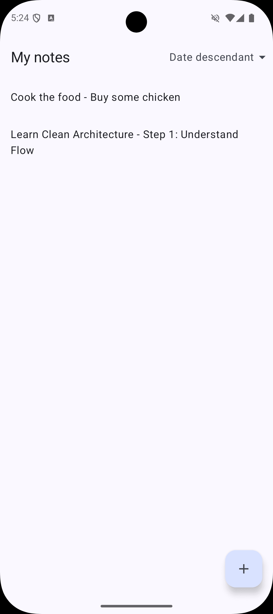
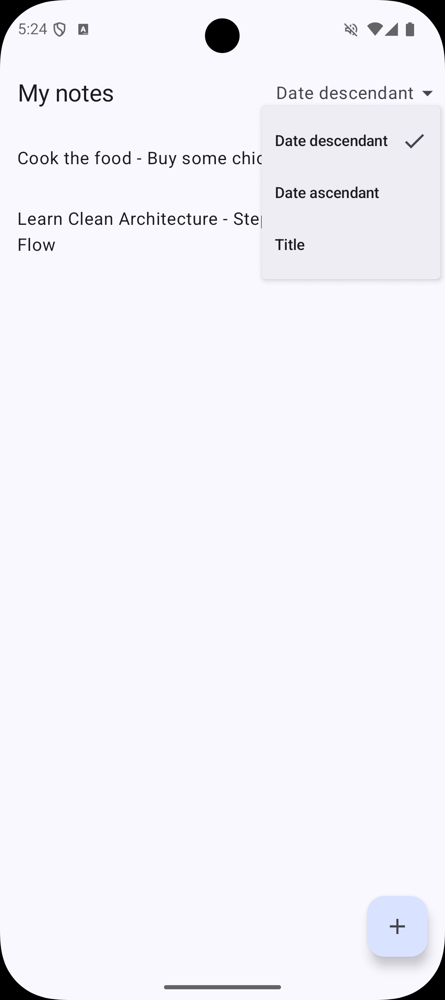
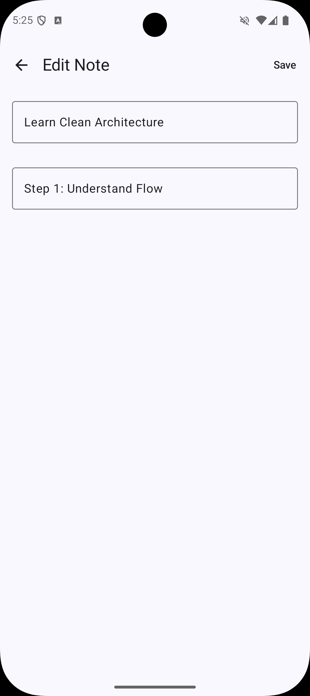
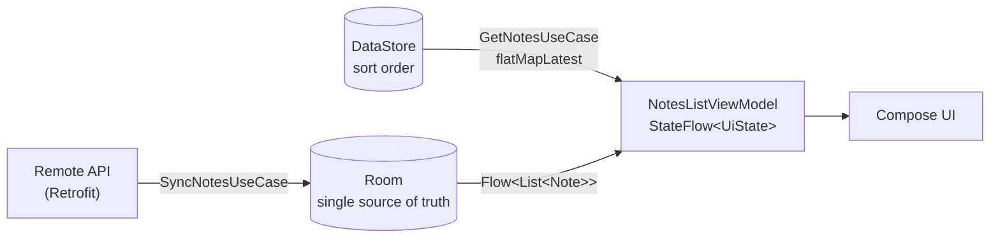

# ModernNotes

A small, offline-first notes app for Android, built with Kotlin and Jetpack Compose —
and a deliberate exercise in writing **every line of code by hand**.

<p align="center">
  
  &nbsp;
  
  &nbsp;
  
</p>

## Why this project exists

Most of my recent work uses AI as an active development partner (see
[GameStack](https://github.com/voltek/GameStack)). ModernNotes was built to prove the opposite
skill: that I can design and write a modern Android app end to end without it.

- Every class — DTOs, entities, mappers, use cases, ViewModels, Hilt modules, tests — was
  written by hand.
- AI was used **only as an auditor**: after each phase, the finished code was reviewed in an
  AI-assisted IDE (Antigravity), which returned corrections and explanations, never code.
- No code-completion assistants (Copilot, Gemini) were used at any point.

## Features

- Notes list with title and content preview
- Create a note and edit an existing one (title + content, both validated as non-blank)
- Three sort orders — date descending, date ascending, title A–Z — **persisted across
  launches** with DataStore
- Loading state while the remote sync runs, and an error message if it fails
- Snackbar feedback for validation and unexpected errors

## Architecture

Clean Architecture in a single module, split into `data`, `domain` and `presentation`
packages, with MVVM in the UI layer (plus MVI-style one-shot events for navigation and
snackbars, sent through a `Channel`).

**Room is the single source of truth.** The UI never reads from the network: the list
screen observes a Room `Flow`, a sync use case fetches remote notes and writes them into
Room, and Room re-emits the change.



A few decisions worth pointing at:

- **The sort preference drives the query.** `GetNotesUseCase` switches the Room query
  with `flatMapLatest` whenever the DataStore value changes, so changing the order is a
  single source of truth too — the ViewModel never sorts a list itself.
- **Time is injected.** `SaveNoteUseCase` takes a `TimeProvider` instead of calling
  `System.currentTimeMillis()`, so tests use a `FakeTimeProvider` and stay deterministic.
- **Validation lives in the domain.** `SaveNoteUseCase` throws a typed
  `InvalidNoteException` (empty title / empty content); the ViewModel maps each case to a
  `UiText` string resource, so no user-facing string is hardcoded outside the UI layer.
- **DTOs and entities never leave the data layer.** Each source has its own mapper to the
  domain `Note`; remote and local models never convert into each other directly.

## Tech stack

| Area | Libraries |
|---|---|
| Language & UI | Kotlin, Jetpack Compose, Material 3 |
| Architecture | Clean Architecture, MVVM, StateFlow, Channel for one-shot events |
| Async | Coroutines, Flow |
| Persistence | Room, DataStore (Preferences) |
| Networking | Retrofit, kotlinx.serialization |
| DI | Hilt |
| Navigation | Navigation Compose with type-safe (`@Serializable`) routes |
| Testing | JUnit 4, MockK, Turbine, kotlinx-coroutines-test, MockWebServer, AndroidX Test |

Min SDK 24 · Target SDK 36.

## Testing

- **13 unit-test classes** covering all seven use cases, both ViewModels, the local and
  remote notes repositories, and both mappers — with shared test factories, a
  `MainDispatcherRule` and a `FakeTimeProvider`.
- The remote repository is tested against a real HTTP layer using **MockWebServer**
  (success and HTTP 500 cases).
- **An instrumented Room test** (`NoteDaoTest`) runs the DAO against an in-memory SQLite
  database, verifying each sort order and the CRUD queries.

```bash
./gradlew test                  # unit tests (JVM)
./gradlew connectedAndroidTest  # instrumented DAO test (needs a device or emulator)
```

## Running the project

Open it in Android Studio and run the `app` configuration. No API keys are needed.

## Known limitations

This is a learning project, and these are stated rather than hidden:

- **There is no real backend.** The remote layer — Retrofit interface, DTO, mapper and
  `RemoteNotesRepositoryImpl` — is implemented and tested against MockWebServer, but the app
  binds `FakeRemoteNotesRepositoryImpl` instead, which returns two demo notes after a simulated
  delay so the loading state can be seen on a device. Swapping in a real API is a one-line
  change in `RepositoryModule`.
- **Deleting a note is implemented in the domain and data layers** (`DeleteNoteUseCase`,
  `NoteDao.deleteNote`) but is not yet exposed in the UI.

---

*The code in this repository was written by hand. This README was drafted with AI
assistance from the codebase and reviewed by me.*
